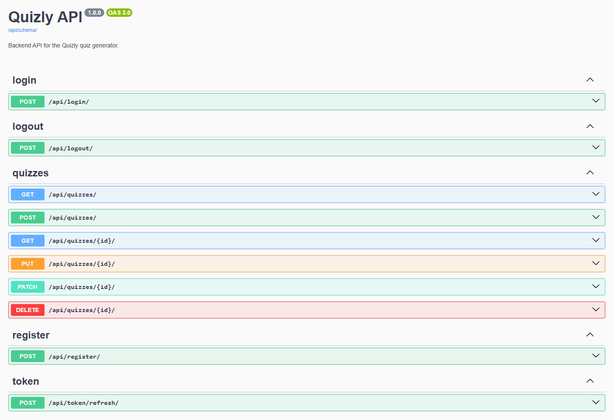

# Quizly Backend

A RESTful backend for **Quizly**, an app that turns YouTube videos into
multiple choice quizzes. It downloads a video's audio track, transcribes it
locally with Whisper AI and lets Gemini Flash generate ten questions from the
transcript, built with Django and the Django REST Framework.

Authentication runs entirely on **JWT stored in HttpOnly cookies**, so the
frontend never handles a token itself. The frontend is provided by the
Developer Akademie and lives in
[project.Quizly](https://github.com/Developer-Akademie-Backendkurs/project.Quizly);
everything behind `/api/` is this project.



---

## Features

- JWT authentication via **HttpOnly cookies** (register, login, logout, refresh)
- Refresh tokens are **blacklisted** on logout and cannot be reused
- Quiz generation from a YouTube URL: download → transcription → AI questions
- Ten questions with four answer options each, generated by **Gemini Flash**
- Local transcription with **Whisper AI**, no audio ever leaves the machine
- Only YouTube URLs are accepted; short links and `/shorts/` URLs are normalised
- Object-level permissions: users only ever see and edit their own quizzes
- Auto-generated OpenAPI 3 documentation (Swagger UI & ReDoc) via drf-spectacular

---

## Tech Stack

**Backend**

<p align="left">
  
  
  
  
  
</p>

| Component      | Version                                        |
| -------------- | ---------------------------------------------- |
| Language       | Python 3.12+ (required by Django 6)            |
| Framework      | Django 6.0.7                                   |
| API            | Django REST Framework 3.17.1                   |
| Database       | SQLite                                         |
| Auth           | djangorestframework-simplejwt 5.5.1 (cookies)  |
| Video → Audio  | yt-dlp 2026.7.4 + FFmpeg                       |
| Transcription  | openai-whisper 20250625 (local)                |
| Quiz AI        | google-genai 2.16.0 (Gemini Flash)             |
| API Docs       | drf-spectacular 0.30.0 (OpenAPI 3)             |

---

## Project Structure

```
quizly_backend/
├── core/          # Project settings, root URL config, WSGI/ASGI
├── auth_app/      # Registration, login, logout, token refresh
│   └── api/       # serializers.py, views.py, urls.py, authentication.py, utils.py
├── quiz_app/      # Quizzes and questions, quiz generation pipeline
│   └── api/       # serializers.py, views.py, urls.py, permissions.py, utils.py
├── manage.py
└── requirements.txt
```

---

## Getting Started

### Prerequisites

- Python 3.12 or newer
- `pip` and `venv`
- **FFmpeg, installed globally and available on your `PATH`**
- A Google Gemini API key (free tier is sufficient)

> ⚠️ **FFmpeg is required.** Whisper AI uses it to decode the downloaded audio,
> and yt-dlp uses it to extract the audio track. Without FFmpeg on your `PATH`
> the quiz generation will fail.

**Windows**

```powershell
winget install --id Gyan.FFmpeg -e --source winget
```

**macOS**

```bash
brew install ffmpeg
```

**Linux (Debian / Ubuntu)**

```bash
sudo apt install ffmpeg
```

Verify the installation, a version number should be printed:

```bash
ffmpeg -version
```

### Installation

1. **Clone the repository**

   ```bash
   git clone https://github.com/B-Blarr/Quizly-Backend.git
   cd Quizly-Backend
   ```

2. **Create and activate a virtual environment**

   ```bash
   python -m venv .venv
   ```

   Activate it. **Windows (PowerShell):**

   ```powershell
   .\.venv\Scripts\Activate.ps1
   ```

   **macOS / Linux:**

   ```bash
   source .venv/bin/activate
   ```

3. **Install the dependencies**

   ```bash
   pip install -r requirements.txt
   ```

   > This pulls in PyTorch as a dependency of Whisper, roughly 2 GB. The
   > installation can take several minutes.

4. **Set up your environment file**, copy the provided template, then fill in
   your own values. The `.env` file itself is git-ignored.

   Windows (PowerShell):

   ```powershell
   Copy-Item .env.template .env
   ```

   macOS / Linux:

   ```bash
   cp .env.template .env
   ```

   | Variable               | Description                                          |
   | ---------------------- | ---------------------------------------------------- |
   | `SECRET_KEY`           | Django secret key, required                          |
   | `GEMINI_API_KEY`       | API key from Google AI Studio, required              |
   | `CORS_ALLOWED_ORIGINS` | Comma separated frontend origins, optional           |

   Generate a secret key with:

   ```bash
   python -c "from django.core.management.utils import get_random_secret_key; print(get_random_secret_key())"
   ```

   Get a Gemini API key at [Google AI Studio](https://aistudio.google.com/apikey).
   `CORS_ALLOWED_ORIGINS` defaults to `http://localhost:5500,http://127.0.0.1:5500`
   (the ports used by the VS Code Live Server extension). Adjust it if your
   frontend runs elsewhere.

5. **Apply the database migrations**

   ```bash
   python manage.py migrate
   ```

6. **(Optional) Create an admin user** to use the Django admin at `/admin/`:

   ```bash
   python manage.py createsuperuser
   ```

7. **Run the development server**

   ```bash
   python manage.py runserver
   ```

   The API is now available at `http://127.0.0.1:8000/`.

> On the first quiz generation Whisper downloads its model file (about 140 MB
> for `base`). This happens once and is cached afterwards.

---

## Frontend

This repository contains the backend only. The matching frontend is provided
by the Developer Akademie:

```bash
git clone https://github.com/Developer-Akademie-Backendkurs/project.Quizly.git
```

It is plain HTML, CSS and JavaScript, so any static file server will do. The
simplest way is the **Live Server** extension in VS Code: right-click
`index.html` and choose *Open with Live Server*.

Two things have to line up:

- The frontend expects the backend at `http://127.0.0.1:8000/api/`, which is
  where `python manage.py runserver` puts it by default.
- The origin the frontend is served from has to be listed in
  `CORS_ALLOWED_ORIGINS`. Live Server uses port `5500`, which is already
  covered by the default. If your setup uses a different port, add it to your
  `.env`.

Without the matching origin the browser blocks every request before it reaches
Django, and the login will silently fail.

---

## Tests

Run the full test suite:

```bash
python manage.py test
```

Measure test coverage (target: **≥ 95 %**):

```bash
coverage run --source=auth_app,quiz_app --omit='*/migrations/*,*/tests/*' manage.py test
coverage report -m
```

The tests never call YouTube, Whisper or Gemini, the pipeline is mocked.

---

## Authentication

The API uses **JWT stored in HttpOnly cookies**, not the `Authorization`
header. Logging in sets two cookies which the browser sends automatically with
every following request:

| Cookie          | Lifetime   | Purpose                          |
| --------------- | ---------- | -------------------------------- |
| `access_token`  | 15 minutes | Authenticates every request      |
| `refresh_token` | 7 days     | Obtains a new access token       |

Because the cookies are `HttpOnly`, JavaScript cannot read them. A frontend
therefore has to send its requests with `credentials: "include"`, and its
origin has to be listed in `CORS_ALLOWED_ORIGINS`.

The login response returns the user's data, never the tokens themselves:

```json
{
  "detail": "Login successfully!",
  "user": {
    "id": 1,
    "username": "max",
    "email": "max@example.com"
  }
}
```

On logout the refresh token is added to a blacklist and both cookies are
deleted, so an old token cannot be reused.

> **Note:** logging in is done with the `username`, not the email address.

---

## API Documentation

Interactive, auto-generated API documentation is available while the server is
running:

| View       | URL                            |
| ---------- | ------------------------------ |
| Swagger UI | `/api/schema/swagger-ui/`      |
| ReDoc      | `/api/schema/redoc/`           |
| Raw schema | `/api/schema/`                 |

---

## API Endpoints

Base path: `/api/`

### Authentication

| Method | Endpoint           | Description                              | Auth           |
| ------ | ------------------ | ---------------------------------------- | -------------- |
| POST   | `/register/`       | Create a new user                        | No             |
| POST   | `/login/`          | Log in and set the auth cookies          | No             |
| POST   | `/logout/`         | Log out, blacklist and clear the tokens  | Authenticated  |
| POST   | `/token/refresh/`  | Renew the access token                   | Refresh cookie |

### Quizzes

| Method | Endpoint          | Description                            | Permission    |
| ------ | ----------------- | -------------------------------------- | ------------- |
| POST   | `/quizzes/`       | Generate a quiz from a YouTube URL     | Authenticated |
| GET    | `/quizzes/`       | List the user's own quizzes            | Authenticated |
| GET    | `/quizzes/{id}/`  | Quiz detail including all questions    | Owner only    |
| PUT    | `/quizzes/{id}/`  | Replace title and description          | Owner only    |
| PATCH  | `/quizzes/{id}/`  | Update the title and description       | Owner only    |
| DELETE | `/quizzes/{id}/`  | Delete the quiz and all its questions  | Owner only    |

Creating a quiz expects a single field:

```json
{ "url": "https://www.youtube.com/watch?v=example" }
```

---

## Conventions & Notes

- **Quiz generation takes time.** A `POST /api/quizzes/` runs the whole
  pipeline synchronously: downloading the audio, transcribing it and querying
  Gemini. Depending on the video length this can take several minutes. The
  request is not broken, it is working.
- **Only YouTube URLs are accepted.** `watch?v=`, `youtu.be`, `/shorts/`,
  `/embed/` and mobile links all work. Anything else is rejected with `400`.
- **`video_url` is normalised.** Whatever form the user submits, the quiz is
  stored with a `https://www.youtube.com/watch?v=<id>` URL, because that is the
  format the frontend needs to embed the video.
- **`question_options`** is a JSON array of answer options, and `answer` always
  matches one of them verbatim. That match is verified before saving; if it
  fails, the request returns `400` instead of storing a quiz in which no answer
  can ever be correct. The number of questions and options is requested in the
  prompt and enforced by the response schema's structure, but not re-checked
  afterwards.
- **403 vs. 404:** accessing a quiz that belongs to someone else returns `403`,
  a quiz that does not exist returns `404`.
- **Models are configurable** in `core/settings.py`: `WHISPER_MODEL` defaults to
  `base` and can be set to `tiny`, `small`, `medium` or `large` to trade speed
  for accuracy, and `GEMINI_MODEL` selects the Gemini variant used for
  generation.
- **Temporary audio files** are written to `tmp/` and deleted right after the
  transcription, including when it fails.
- **Cookie security:** the `secure` flag on both cookies follows `DEBUG`, so
  cookies are sent over plain HTTP in development and require HTTPS otherwise.
